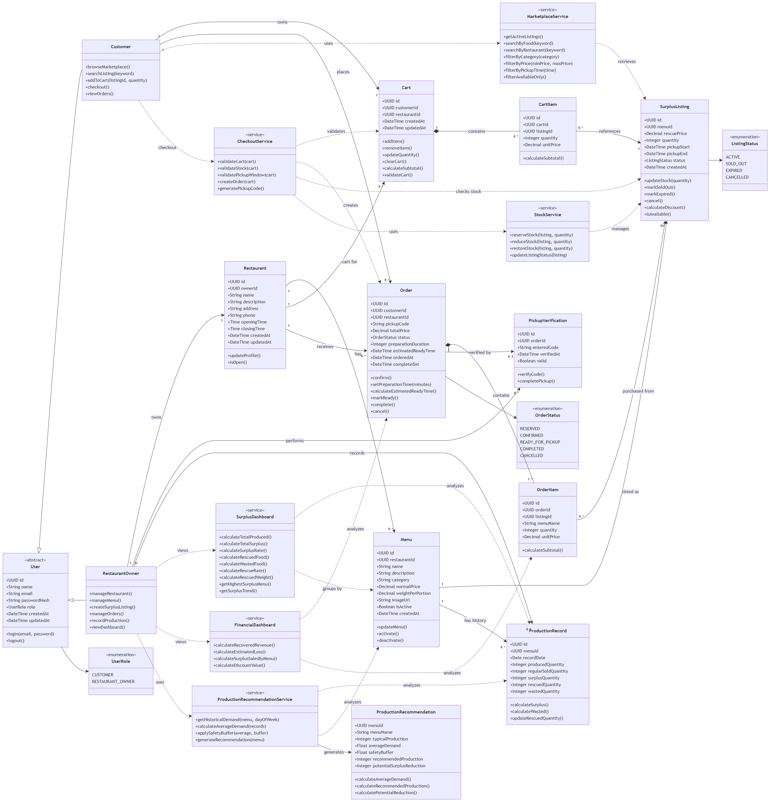

# REPLATE

Replate adalah aplikasi marketplace yang membantu restoran menjual makanan surplus yang masih layak konsumsi dengan harga lebih terjangkau. Selain membantu mengurangi food waste, Replate juga menyediakan analisis surplus dan rekomendasi jumlah produksi agar restoran dapat mengurangi kerugian serta mencegah kelebihan produksi di masa mendatang.

## Class Diagram



## Database PostgreSQL

Implementasi 11 tabel berdasarkan [ERD Replate](./erd-replate.mmd) tersedia di
[`database/schema.sql`](./database/schema.sql). Ikuti [panduan database Modul 5](./database/README.md)
untuk membuat database dan menampilkan bukti struktur tabel.

## Implementasi C#

Class diagram di atas diimplementasikan sebagai C# class library dengan .NET 10.

| Komponen | Hasil coding |
| --- | --- |
| Entity dan relasi | [`src/Replate.Domain/Entities`](./src/Replate.Domain/Entities) |
| Enumeration | [`src/Replate.Domain/Enums`](./src/Replate.Domain/Enums) |
| Service | [`src/Replate.Domain/Services`](./src/Replate.Domain/Services) |
| Runnable checks | [`tests/Replate.Domain.Checks/Program.cs`](./tests/Replate.Domain.Checks/Program.cs) |

Jalankan implementasi dengan:

```bash
dotnet build Replate.slnx
dotnet run --project tests/Replate.Domain.Checks/Replate.Domain.Checks.csproj
```

## User Interface Avalonia

Aplikasi desktop tersedia di [`src/Replate.Desktop`](./src/Replate.Desktop), dengan
area pelanggan dan restoran terpisah. Halaman pelanggan memakai bar atas
(logo, kolom cari, keranjang, dan menu profil);
dashboard dan pengelolaan restoran memakai sidebar operasional. Keranjang,
detail pesanan, serta formulir menggunakan halaman penuh. Tombol Tambah pada kartu
makanan membuka pop up detail dengan pengatur jumlah porsi.

```bash
dotnet run --project src/Replate.Desktop
```

### Menjalankan Replate.Desktop.exe

1. Letakkan file `.env` dan `prod-ca-2021.crt` di folder yang sama dengan `Replate.Desktop.exe`.
2. Isi `.env` dengan format `KEY=VALUE` per baris, misalnya `REPLATE_SUPABASE_URL`,
   `REPLATE_SUPABASE_PUBLISHABLE_KEY`, dan `REPLATE_DB_PASSWORD`. Baris kosong dan baris
   berawalan `#` diabaikan.
3. Klik dua kali `Replate.Desktop.exe`.

Saat dibuka, aplikasi membaca `.env` lalu membentuk koneksi Supabase (session pooler, port 5432,
SSL VerifyFull) dari `REPLATE_SUPABASE_URL` dengan sertifikat `prod-ca-2021.crt`. Variabel yang
sudah diatur oleh `Run-ReplateSupabase.ps1` atau `Setup-Replate.ps1` tidak ditimpa. Jangan
commit file `.env` karena berisi kata sandi dan key.

Halaman Jelajah dibuka dengan banner sapaan, lalu lima kartu koleksi (Termurah, Segera
berakhir, Makanan utama, Roti & kue, Buah & sayur) yang masing-masing membuka halamannya
sendiri, dan daftar semua makanan berbentuk kartu. Enter atau ikon kaca pembesar di
kolom cari membuka halaman hasil pencarian.
Pelanggan dapat mencari makanan, mengatur keranjang, melakukan simulasi reservasi,
dan memantau pesanan. Satu keranjang boleh berisi menu dari beberapa restoran;
setiap restoran dipesan terpisah dari keranjang (satu pesanan per restoran) melalui pop up konfirmasi, secara atomik. Restoran dapat mengelola menu dan penawaran, mencatat produksi,
mengonfirmasi pesanan, serta memverifikasi kode pengambilan. Dashboard menampilkan
analisis surplus dan rekomendasi produksi berdasarkan model domain yang ada.

Data awal merupakan **contoh lokal**, dengan perubahan tersimpan otomatis di JSON.
Akun memakai autentikasi lokal tingkat prototype: kata sandi di-hash dengan PBKDF2
dan disimpan di JSON lokal, bukan autentikasi produksi. Belum terhubung ke
PostgreSQL untuk akun atau pembayaran. Lihat
[panduan, alur demonstrasi, dan screenshot](./src/Replate.Desktop/README.md).

# REPLATE TEAM

Ketua Kelompok: Diaz Amantajati Susilo - 24/545483/TK/60678

Anggota 1: Violin Mulya Putra - 24/534192/TK/59201

Anggota 2: Putri Tajudin - 24/535824/TK/59469
