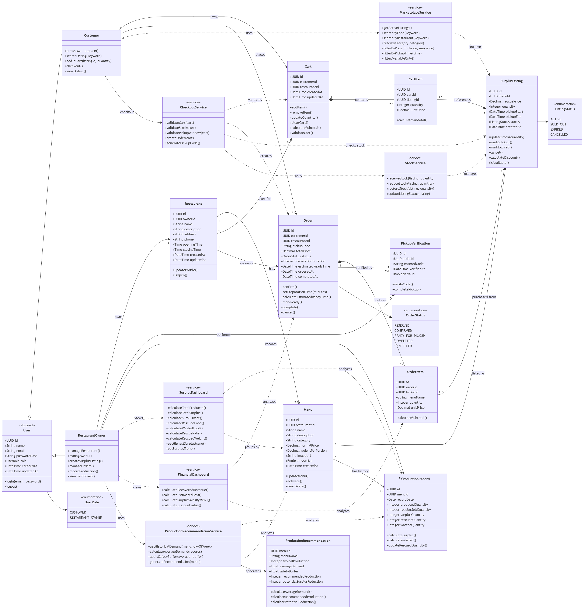

# REPLATE

Replate adalah aplikasi marketplace yang membantu restoran menjual makanan surplus yang masih layak konsumsi dengan harga lebih terjangkau. Selain membantu mengurangi food waste, Replate juga menyediakan analisis surplus dan rekomendasi jumlah produksi agar restoran dapat mengurangi kerugian serta mencegah kelebihan produksi di masa mendatang.

## Class Diagram



## Implementasi Class Diagram

Class diagram di atas diimplementasikan sebagai C# class library dengan .NET 10.

| Komponen | Hasil coding |
| --- | --- |
| Entity dan relasi | [`src/Replate.Domain/Entities`](./src/Replate.Domain/Entities) |
| Enumeration | [`src/Replate.Domain/Enums`](./src/Replate.Domain/Enums) |
| Service | [`src/Replate.Domain/Services`](./src/Replate.Domain/Services) |
| Runnable checks | [`tests/Replate.Domain.Checks/Program.cs`](./tests/Replate.Domain.Checks/Program.cs) |

Jalankan implementasi dengan:

```bash
dotnet build Replate.slnx
dotnet run --project tests/Replate.Domain.Checks/Replate.Domain.Checks.csproj
```

## User Interface Avalonia

Aplikasi desktop tersedia di [`src/Replate.Desktop`](./src/Replate.Desktop), dengan
area pelanggan dan restoran terpisah. Marketplace memakai navigasi pelanggan;
dashboard dan pengelolaan restoran memakai sidebar operasional. Keranjang,
detail makanan/pesanan, serta formulir menggunakan halaman penuh.

```bash
dotnet run --project src/Replate.Desktop
```

Pelanggan dapat mencari makanan, mengatur keranjang, melakukan simulasi reservasi,
dan memantau pesanan. Restoran dapat mengelola menu dan penawaran, mencatat produksi,
mengonfirmasi pesanan, serta memverifikasi kode pengambilan. Dashboard menampilkan
analisis surplus dan rekomendasi produksi berdasarkan model domain yang ada.

Data awal merupakan **contoh lokal**, dengan perubahan tersimpan otomatis di JSON.
Belum terhubung ke PostgreSQL, autentikasi nyata, atau pembayaran. Lihat
[panduan, alur demonstrasi, dan screenshot](./src/Replate.Desktop/README.md).

# REPLATE TEAM

Ketua Kelompok: Diaz Amantajati Susilo - 24/545483/TK/60678

Anggota 1: Violin Mulya Putra - 24/534192/TK/59201

Anggota 2: Putri Tajudin - 24/535824/TK/59469
