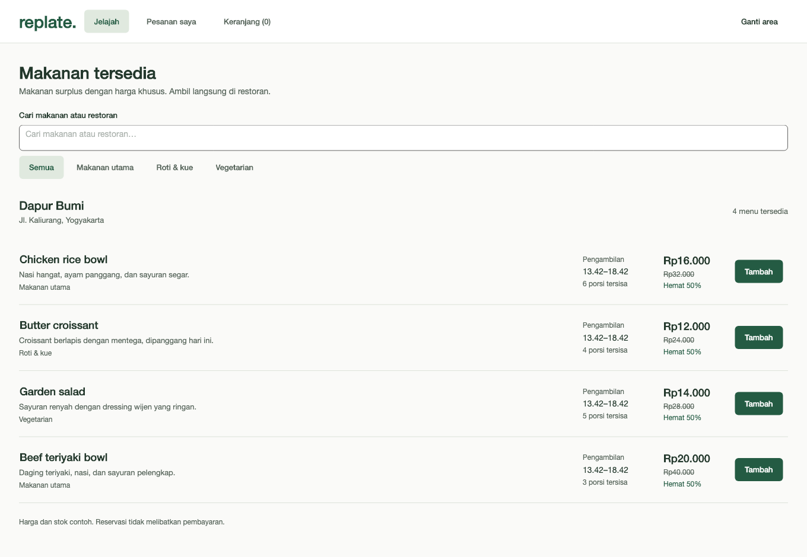
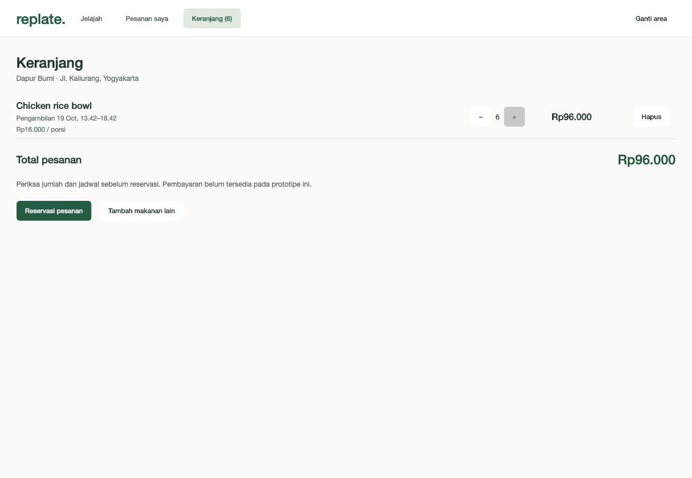

# Replate Desktop

Aplikasi Avalonia UI 12.1.4 / .NET 10 dengan area pelanggan dan pemilik restoran
terpisah. Seluruh layar, keranjang, detail pesanan, dan formulir memakai halaman
penuh; detail makanan tampil sebagai pop up di atas halaman. Pelanggan menggunakan bar atas berisi logo putih
(ke Jelajah), kolom cari, ikon keranjang dengan jumlah item, dan lingkaran profil
yang membuka menu **Pesanan saya** dan **Keluar**; restoran memiliki sidebar operasional.

## Menjalankan

Dari root repository:

```bash
dotnet restore Replate.slnx
dotnet run --project src/Replate.Desktop
```

Aplikasi dibuka di layar **Masuk**. Masuk dengan akun demo (lihat tabel di bawah)
atau pilih **Daftar akun baru**. Layar Masuk dan Daftar memakai kolom kiri berlatar
terang dan panel hijau penuh tinggi di kanan. Batas kiri panel hijau tepat melewati
titik tengah foto piring `Assets/auth-hero.png` (tanpa teks): setengah piring di atas
latar terang dan setengah di atas panel hijau. Batas itu berada di sekitar 72% lebar
jendela, sehingga panel hijau sekitar 28% lebar. Diameter piring sekitar 56% tinggi
jendela. Kartu formulir mulai di sekitar 12% lebar jendela (minimal 48) dan berjarak
sekitar 8% lebar jendela dari piring; pada jendela kecil jarak itu mengecil sampai
minimal 24. Logo hijau
tetap di atas, sejajar dengan tepi kiri kartu, sedangkan satu kartu formulir di
bawahnya dapat digulir vertikal; baris akun demo mengikuti lebar dan tepi kiri kartu. Area gulir memakai scrollbar tipis tanpa
track dan tanpa tombol panah yang hanya tampil saat menggulir atau saat kursor berada
di atasnya; gulir tetap bekerja dengan roda mouse, touchpad, dan keyboard, dan kolom
yang dicapai dengan Tab otomatis tergulir ke tampilan. Setiap kolom kata sandi memiliki tombol mata yang
selalu terlihat untuk menampilkan atau menyembunyikan isi. Di Daftar, peran dipilih
dengan dua tombol **Pelanggan** / **Pemilik restoran** (bisa juga dengan tombol panah),
dan Jam buka serta Jam tutup dipilih dari daftar jam 00 sampai 23 dan menit 00 sampai
59 (format 24 jam). Jika database belum tersambung, peringatan ringkas tampil di atas kartu Masuk. Pelanggan diarahkan ke marketplace, pemilik
restoran ke dashboard restorannya. **Keluar** di menu profil pelanggan atau sidebar
restoran mengakhiri sesi dan kembali ke layar Masuk. Halaman pelanggan hanya untuk
pelanggan yang masuk; halaman restoran hanya untuk pemilik restoran tersebut. Peran
yang tidak sesuai atau belum masuk diarahkan kembali ke layar Masuk.

## Akun demo

Autentikasi bersifat lokal tingkat prototype. Akun disimpan di `state.json` dengan
kata sandi yang di-hash PBKDF2-HMAC-SHA256; kata sandi polos tidak disimpan. Sesi
masuk tidak diingat antar peluncuran. Semua akun demo memakai kata sandi `replate123`.

| Peran | Email | Restoran |
| --- | --- | --- |
| Pelanggan | `pelanggan@replate.demo` | — |
| Pemilik restoran | `dapur-bumi@replate.demo` | Dapur Bumi |
| Pemilik restoran | `warung-sambal-ijo@replate.demo` | Warung Sambal Ijo |
| Pemilik restoran | `roti-pagi-kotabaru@replate.demo` | Roti Pagi Kotabaru |

Restoran tanpa pemilik (misalnya hasil migrasi data versi 1) otomatis mendapat akun
pemilik demo dengan email dari nama restoran, contoh `dapur-bumi@replate.demo`.
Akun demo tidak digandakan dan tidak menimpa akun yang sudah ada.

## Halaman

| Area | Halaman | Fungsi |
| --- | --- | --- |
| Awal | Masuk | Kartu email dan kata sandi di samping foto; arah halaman mengikuti peran akun |
| Awal | Daftar | Kartu akun pelanggan atau pemilik restoran beserta profil restoran, di samping foto |
| Pelanggan | Jelajah | Banner sapaan, kartu koleksi (Termurah, Segera berakhir, Makanan utama, Roti & kue, Buah & sayur) yang membuka halamannya sendiri, semua kartu makanan dengan harga, stok, jadwal pengambilan |
| Pelanggan | Koleksi | Tautan Kembali ke Jelajah, judul koleksi dengan kalimat pengantar, kartu makanan terurut (harga atau batas pengambilan) atau tersaring per kategori |
| Pelanggan | Hasil pencarian | Dibuka dengan Enter atau ikon kaca pembesar di bar atas; judul "Hasil untuk {kata}", semua kata harus cocok dengan nama menu, deskripsi, restoran, atau kategori |
| Pelanggan | Pop up detail makanan | Dibuka dari tombol Tambah atau klik kartu makanan; foto, deskripsi, harga, stok, jadwal, pengatur jumlah porsi, tambah ke keranjang tanpa pindah halaman |
| Pelanggan | Keranjang | Tautan Kembali ke Jelajah, kartu item dikelompokkan per restoran (nama, subtotal, tombol Pesan) dengan pengatur jumlah dan ikon hapus, pop up Konfirmasi pesanan (item, jendela pengambilan, total, Batal dan Pesan sekarang), keadaan kosong dengan tombol Jelajahi menu |
| Pelanggan | Pesanan saya | Filter pesanan aktif, selesai, dibatalkan |
| Pelanggan | Detail pesanan | Status, rincian, kode pengambilan, pembatalan |
| Restoran | Dashboard | Periode 7/28 hari, surplus, penjualan selesai, rekomendasi |
| Restoran | Menu | Daftar menu, harga normal, aktif/nonaktif |
| Restoran | Tambah/ubah menu | Nama, deskripsi, kategori, harga, berat |
| Restoran | Penawaran surplus | Daftar penawaran, stok, jadwal, tutup penawaran |
| Restoran | Buat/ubah penawaran | Harga rescue, stok dan jadwal pengambilan |
| Restoran | Catatan produksi | Produksi dan penjualan reguler per menu/tanggal |
| Restoran | Pesanan | Daftar dan filter pesanan restoran |
| Restoran | Detail/pengambilan | Konfirmasi, estimasi persiapan, siap diambil, verifikasi kode |

## Alur demonstrasi

1. Di layar **Masuk**, masuk sebagai `pelanggan@replate.demo` / `replate123`.
2. Klik **Tambah** pada kartu makanan, atur jumlah porsi di pop up, lalu
   **Tambah ke keranjang**. Buka keranjang, klik **Pesan** pada kelompok restoran, lalu **Pesan sekarang** di pop up konfirmasi. Catat kode
   pengambilan di detail pesanan.
3. Lingkaran profil → **Keluar**, lalu masuk sebagai `dapur-bumi@replate.demo` / `replate123`
   (atau pemilik restoran tempat makanan dipesan) → **Pesanan** → **Lihat pesanan**.
4. Isi estimasi persiapan → **Konfirmasi pesanan** → **Tandai siap diambil**.
5. Masukkan kode pelanggan → **Verifikasi dan selesaikan**.
6. Pesanan menjadi selesai, porsi terselamatkan bertambah pada produksi menu,
   dan dashboard memperbarui pendapatan yang dipulihkan.

Restoran baru: **Keluar** → **Daftar akun baru** → pilih **Pemilik restoran**, isi
akun dan **Profil restoran** (untuk buka 24 jam, isi 00:00 sampai 23:59) → **Daftar**.
Dashboard restoran baru masih kosong dan menawarkan **Tambah menu**.

Untuk pasokan baru: **Menu** → **Tambah menu**, lalu **Produksi** → catat produksi
serta penjualan reguler. Setelah itu buat **Penawaran surplus** dengan stok yang
belum dialokasikan. Prototipe memakai kategori makanan utama, roti & kue, vegetarian.

## Aturan dan data lokal

- Data awal adalah contoh Dapur Bumi, bukan transaksi restoran nyata.
- Perubahan disimpan otomatis dalam JSON di direktori data lokal pengguna:
  `Path.Combine(Environment.GetFolderPath(LocalApplicationData), "Replate", "state.json")`.
  Pada macOS, lokasi umumnya `~/Library/Application Support/Replate/state.json`.
- Snapshot terpisah dari graf navigasi domain; penulisan berkas memakai penggantian atomik.
- Keranjang, menu, penawaran, produksi, dan status pesanan bertahan setelah restart.
- Satu keranjang boleh berisi menu dari beberapa restoran. Setiap restoran dipesan
  terpisah: **Pesan** pada kelompok restoran membuka pop up konfirmasi, dan **Pesan
  sekarang** membuat tepat satu pesanan untuk restoran itu dengan kode pengambilan
  sendiri, hanya terlihat oleh pemilik restoran tersebut. Item restoran lain tetap di
  keranjang. Pesanan disimpan ke PostgreSQL dalam satu transaksi; bila gagal, stok dan
  keranjang tidak berubah dan tidak ada pesanan yang tersimpan.
- Penawaran yang sudah melewati waktu pengambilan tidak muncul di marketplace.
  Item keranjang yang kedaluwarsa masih dapat dihapus, tetapi tidak dapat dipesan.
- Stok dibatasi oleh surplus setelah penjualan reguler, porsi terselamatkan, dan
  alokasi penawaran/pesanan lain. Pembatalan pesanan mengembalikan stok satu kali.
- Pengambilan harus berstatus siap dan kode harus cocok; penyelesaian tidak dapat
  diulang untuk menggandakan porsi terselamatkan.
- Berkas yang tidak dapat dibaca dipertahankan. Aplikasi menampilkan peringatan dan
  menolak perubahan agar berkas asli tidak tertimpa data baru.
- Data lokal hanya untuk satu pengguna/satu aplikasi. Belum ada sinkronisasi antar
  perangkat, koneksi PostgreSQL untuk akun, atau pembayaran. Autentikasi memakai
  akun lokal tingkat prototype, bukan autentikasi produksi.

Dashboard menghitung rekomendasi dari rata-rata penjualan reguler pada periode
terpilih ditambah buffer dua porsi, mengikuti model domain; bukan machine learning.
Terbuang dan estimasi nilai terbuang hanya memakai hari yang sudah berakhir.
Surplus hari ini masih dapat diselamatkan. Pendapatan berdasarkan pesanan selesai,
dikelompokkan menurut tanggal pemesanan. Tidak ada rekomendasi tanpa riwayat produksi.

## Screenshot

Screenshot native jendela 1360 × 940 dan ukuran minimum 1040 × 720 tersedia di
[`docs/ui`](../../docs/ui). Marketplace dan dashboard adalah halaman terpisah.
Pada halaman yang panjang, gulir untuk bagian berikutnya.







## Verifikasi

```bash
dotnet build Replate.slnx
dotnet run --project tests/Replate.Domain.Checks
dotnet run --project src/Replate.Desktop -- --verify-state
dotnet run --project src/Replate.Desktop -- --verify-ui /tmp/replate-ui-preview
```

Normal startup initializes PostgreSQL before opening the window. Configure the connection, including the password,
with `REPLATE_DB_CONNECTION_STRING` when the local PostgreSQL server requires authentication, for example:

`REPLATE_DB_CONNECTION_STRING="Host=localhost;Port=5432;Database=replate_db;Username=postgres;Password=..."`

Alternatively, keep the connection string without a password and set only `REPLATE_DB_PASSWORD`.

If PostgreSQL is unavailable, the application still opens and displays a warning; checkout reports the database
failure instead of terminating the desktop process, and leaves stock, cart, and orders unchanged.

Pemeriksaan state memakai berkas sementara terisolasi: muat ulang keranjang/status,
timestamp, stok, pickup salah/benar, pembatalan berulang, kapasitas surplus, tanggal,
harga, menu nonaktif, kedaluwarsa, perlindungan berkas rusak, serta akun: pendaftaran,
login, akun demo, isolasi antar pemilik, dan keranjang per pelanggan. Pemeriksaan UI
membuka jendela native, menjalankan alur lintas area, menyimpan screenshot, lalu
menutup otomatis. Untuk layar Masuk dan Daftar, pemeriksaan UI juga memastikan pada
1360 × 940, 1040 × 720, 1283 × 780, dan 1920 × 1080: batas panel hijau berada di
tengah piring (setengah di atas latar terang, toleransi 0,02 diameter) dan di sekitar
72% lebar (panel sekitar 28%), tepi kiri kartu di sekitar 12% lebar dan minimal 48,
piring tidak berpotongan dengan kartu (jarak minimal 24, dan minimal 8% lebar pada
1360 × 940, 1283 × 780, dan 1920 × 1080), kartu tidak terpotong,
logo dan baris akun demo sejajar tepi kiri kartu, logo tidak terpotong saat
digulir, tidak ada gulir horizontal, tidak ada scrollbar bertrack atau berpanah yang
tampil, dan setiap kolom yang difokuskan dengan Tab tergulir ke tampilan. Pemeriksaan
juga mencakup judul tebal tanpa subjudul, tombol mata yang terlihat saat kolom kosong
dan mengganti mode, tombol peran yang eksklusif dan bisa dipakai dengan keyboard,
kolom jam yang menghasilkan `TimeOnly` 24 jam tanpa AM/PM, serta hover tombol.
Langkah salin kode pengambilan memakai clipboard sistem dan gagal bila clipboard
tidak tersedia di lingkungan pengujian. Kedua pemeriksaan tidak menggunakan berkas data aplikasi normal.
