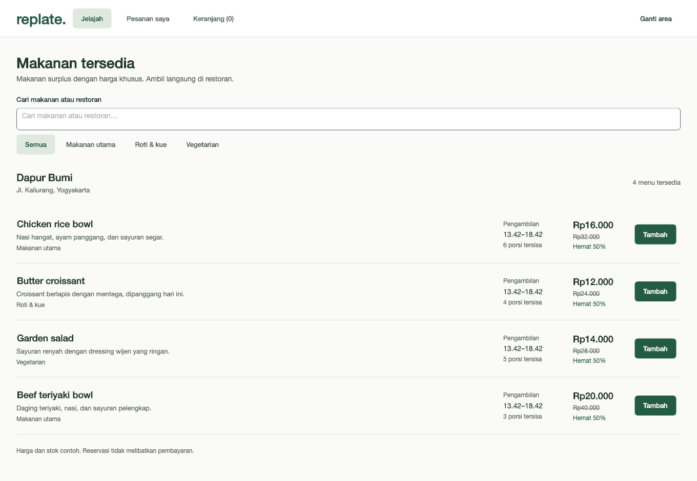
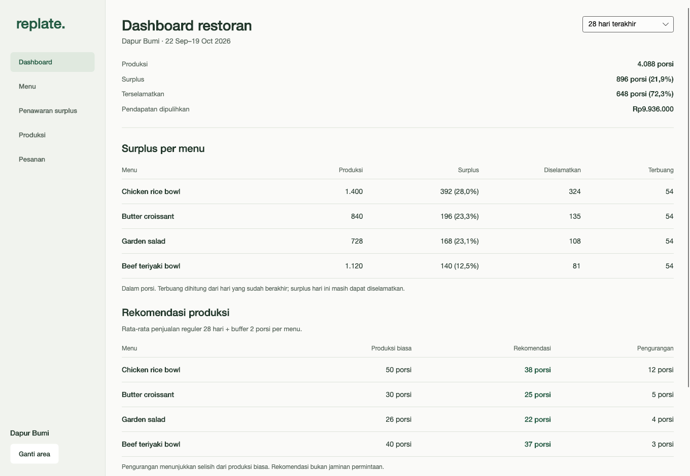
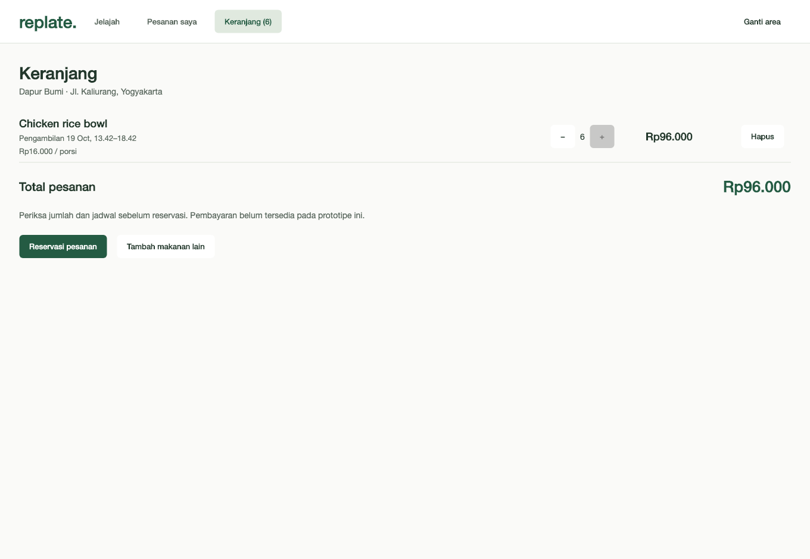
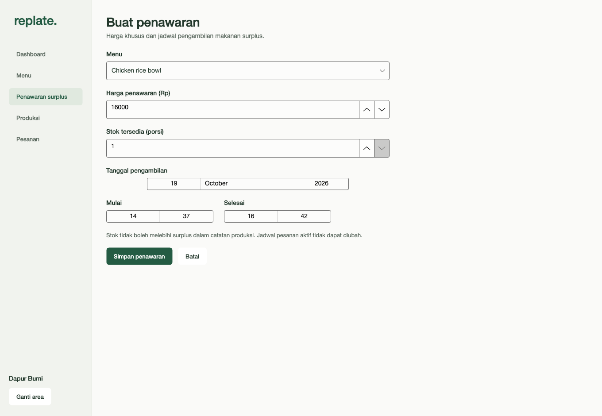

# Replate Desktop

Aplikasi Avalonia UI 12.1.4 / .NET 10 dengan area pelanggan dan pemilik restoran
terpisah. Seluruh layar, keranjang, detail pesanan, dan formulir memakai halaman
penuh. Pelanggan menggunakan navigasi atas; restoran memiliki sidebar operasional.

## Menjalankan

Dari root repository:

```bash
dotnet restore Replate.slnx
dotnet run --project src/Replate.Desktop
```

Pilih **Jelajahi makanan** atau **Buka area restoran**. **Ganti area** kembali ke
pemilihan area. Ini navigasi demonstrasi, bukan login atau pemeriksaan hak akses.

## Halaman

| Area | Halaman | Fungsi |
| --- | --- | --- |
| Awal | Pilih area | Memisahkan konteks pelanggan dan restoran |
| Pelanggan | Marketplace | Cari, filter, lihat harga, stok, jadwal pengambilan |
| Pelanggan | Detail makanan | Deskripsi, harga, jumlah porsi, tambah ke keranjang |
| Pelanggan | Keranjang | Ubah jumlah, hapus item, periksa total, reservasi |
| Pelanggan | Pesanan saya | Filter pesanan aktif, selesai, dibatalkan |
| Pelanggan | Detail pesanan | Status, rincian, kode pengambilan, pembatalan |
| Restoran | Dashboard | Periode 7/28 hari, surplus, penjualan selesai, rekomendasi |
| Restoran | Menu | Daftar menu, harga normal, aktif/nonaktif |
| Restoran | Tambah/ubah menu | Nama, deskripsi, kategori, harga, berat |
| Restoran | Penawaran surplus | Daftar penawaran, stok, jadwal, tutup penawaran |
| Restoran | Buat/ubah penawaran | Harga rescue, stok dan jadwal pengambilan |
| Restoran | Catatan produksi | Produksi dan penjualan reguler per menu/tanggal |
| Restoran | Pesanan | Daftar dan filter pesanan restoran |
| Restoran | Detail/pengambilan | Konfirmasi, estimasi persiapan, siap diambil, verifikasi kode |

## Alur demonstrasi

1. Pelanggan memilih makanan, membuka keranjang, lalu **Reservasi pesanan**.
2. Catat kode pengambilan di detail pesanan.
3. **Ganti area** → **Buka area restoran** → **Pesanan** → **Lihat pesanan**.
4. Isi estimasi persiapan → **Konfirmasi pesanan** → **Tandai siap diambil**.
5. Masukkan kode pelanggan → **Verifikasi dan selesaikan**.
6. Pesanan menjadi selesai, porsi terselamatkan bertambah pada produksi menu,
   dan dashboard memperbarui pendapatan yang dipulihkan.

Untuk pasokan baru: **Menu** → **Tambah menu**, lalu **Produksi** → catat produksi
serta penjualan reguler. Setelah itu buat **Penawaran surplus** dengan stok yang
belum dialokasikan. Prototipe memakai kategori makanan utama, roti & kue, vegetarian.

## Aturan dan data lokal

- Data awal adalah contoh Dapur Bumi, bukan transaksi restoran nyata.
- Perubahan disimpan otomatis dalam JSON di direktori data lokal pengguna:
  `Path.Combine(Environment.GetFolderPath(LocalApplicationData), "Replate", "state.json")`.
  Pada macOS, lokasi umumnya `~/Library/Application Support/Replate/state.json`.
- Snapshot terpisah dari graf navigasi domain; penulisan berkas memakai penggantian atomik.
- Keranjang, menu, penawaran, produksi, dan status pesanan bertahan setelah restart.
- Penawaran yang sudah melewati waktu pengambilan tidak muncul di marketplace.
  Item keranjang yang kedaluwarsa masih dapat dihapus, tetapi tidak dapat dipesan.
- Stok dibatasi oleh surplus setelah penjualan reguler, porsi terselamatkan, dan
  alokasi penawaran/pesanan lain. Pembatalan pesanan mengembalikan stok satu kali.
- Pengambilan harus berstatus siap dan kode harus cocok; penyelesaian tidak dapat
  diulang untuk menggandakan porsi terselamatkan.
- Berkas yang tidak dapat dibaca dipertahankan. Aplikasi menampilkan peringatan dan
  menolak perubahan agar berkas asli tidak tertimpa data baru.
- Data lokal hanya untuk satu pengguna/satu aplikasi. Belum ada sinkronisasi antar
  perangkat, koneksi PostgreSQL, autentikasi nyata, atau pembayaran.

Dashboard menghitung rekomendasi dari rata-rata penjualan reguler pada periode
terpilih ditambah buffer dua porsi, mengikuti model domain; bukan machine learning.
Terbuang dan estimasi nilai terbuang hanya memakai hari yang sudah berakhir.
Surplus hari ini masih dapat diselamatkan. Pendapatan berdasarkan pesanan selesai,
dikelompokkan menurut tanggal pemesanan. Tidak ada rekomendasi tanpa riwayat produksi.

## Screenshot

Screenshot native jendela 1360 × 940 dan ukuran minimum 1040 × 720 tersedia di
[`docs/ui`](../../docs/ui). Marketplace dan dashboard adalah halaman terpisah.
Pada halaman yang panjang, gulir untuk bagian berikutnya.









## Verifikasi

```bash
dotnet build Replate.slnx
dotnet run --project tests/Replate.Domain.Checks
dotnet run --project src/Replate.Desktop -- --verify-state
dotnet run --project src/Replate.Desktop -- --verify-ui /tmp/replate-ui-preview
```

Pemeriksaan state memakai berkas sementara terisolasi: muat ulang keranjang/status,
timestamp, stok, pickup salah/benar, pembatalan berulang, kapasitas surplus, tanggal,
harga, menu nonaktif, kedaluwarsa, dan perlindungan berkas rusak. Pemeriksaan UI
membuka jendela native, menjalankan alur lintas area, menyimpan screenshot, lalu
menutup otomatis. Kedua pemeriksaan tidak menggunakan berkas data aplikasi normal.
